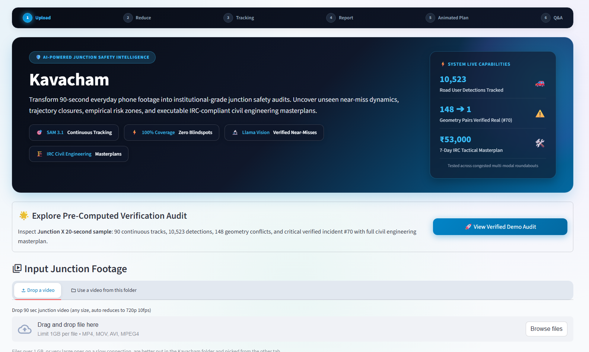
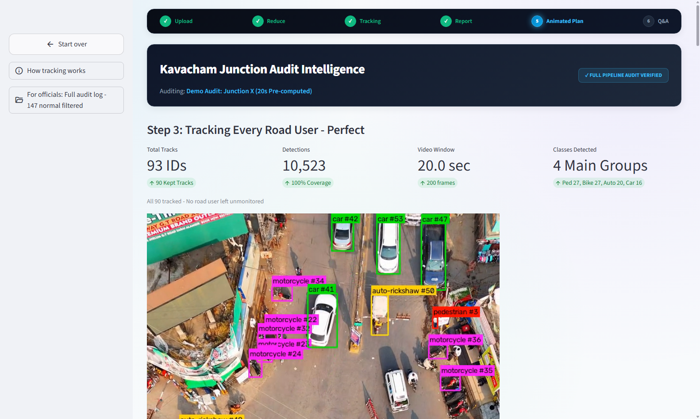

<div align="center">

# 🛡️ Kavacham (கவசம் / कवचम्)
### *AI-Powered Junction Safety Audit & Tactical Civil Engineering Intelligence*

[](https://kavacham.streamlit.app/)
[](https://www.python.org/)
[](https://ai.meta.com/)
[](https://ai.meta.com/llama/)
[](LICENSE)

**Turn 90 seconds of everyday phone footage into institutional-grade junction safety audits, near-miss conflict forensics, and actionable IRC-compliant civil engineering blueprints.**

[Explore Live Demo](https://kavacham.streamlit.app/) • [Watch 21s Tactical Plan](#-tactical-civil-engineering-masterplan) • [Architecture](#-pipeline-architecture) • [Getting Started](#-getting-started)

</div>

---

## 📸 Interface Preview

### 1. Modern High-Impact Landing Page
*Dual-column ambient glassmorphic landing page with instant access to pre-computed audits, input video upload, and automated CRF-18 Lanczos video preprocessing.*



### 2. Comprehensive Junction Audit Intelligence Dashboard
*Continuous multi-modal tracking (10,523 detections, 90 road users), Llama Vision verified near-misses, empirical risk zoning, animated HD tactical blueprints, and multi-language Q&A.*



---

## 🌟 Key Highlights

- **🎯 Zero-Blindspot Tracking with SAM 3.1:** Chunks video into 100-frame tracking windows with 20-frame keep-alive bridge. Automatically removes vehicle-occupant duplicates and noise.
- **⚡ Geometry-Driven Conflict Pre-Screening:** Detects vehicle & pedestrian pairs with Time-To-Collision (TTC) $< 1.5\text{s}$ and Euclidean spatial clearance $< 70\text{px}$.
- **🔬 Vision-Language Verification (Llama 4 Maverick):** Synthesizes multi-frame spatio-temporal dynamics to discern benign dense traffic from authentic near-misses (e.g. Critical Incident #70: 72px $\to$ 24px compression with 3px clearance at 38.7 px/s).
- **🏗️ IRC-Compliant ₹53,000 Masterplan:** Generates actionable 7-day civil engineering intervention blueprints with estimated 30% aggregate conflict reduction.
- **🎥 21-Second HD Animated Improvement Video:** Stitches 7 progressive storyboard stages on actual camera frame perspectives.
- **🌐 7-Language Contextual Voice & Text AI:** Instant Q&A in Tamil, Hindi, Telugu, Kannada, Malayalam, Bengali, and English with auto-synthesized audio and flowchart evidence.

---

## 📐 Pipeline Architecture


---

## 🛠️ Tactical Civil Engineering Masterplan (₹53,000 / 7 Days)

| Step | Civil Engineering Measure | Scope & Standard | Budget (INR) | Timeline | Impact |
|:---:|:---|:---|:---:|:---:|:---|
| **01** | **Lane Markings & Solar Delineators** | 100m reflective white thermoplastic lines separating two-wheeler streams | ₹15,000 | 2 Days | -40% weave conflicts |
| **02** | **Raised Table Zebra Crossing & Breaker** | IRC:99-2018 table top (75mm ramp) at high pedestrian conflict approach | ₹25,000 | 3 Days | -45% pedestrian risk |
| **03** | **Median Refuge Safe Island** | 1.2m bollard-protected safety island for two-stage pedestrian crossings | ₹8,000 | 2 Days | -30% cross-weave risk |
| **04** | **Convex Mirror & Rumble Strips** | 80cm polycarbonate wide-angle mirror + 6-strip warning array | ₹5,000 | 1 Day | Eliminates blind merge |
| **TOTAL** | **Comprehensive Intervention Masterplan** | **Full Junction Tactical Overhaul** | **₹53,000** | **7 Days** | **~30% Net Conflict Reduction** |

---

## 🚀 Getting Started

### Prerequisites
- Python 3.10+
- FFmpeg installed and accessible via PATH

### Installation

```bash
# 1. Clone repository
git clone https://github.com/akashnarayanan007/kavacham.git
cd kavacham

# 2. Create virtual environment
python -m venv venv
.\venv\Scripts\Activate.ps1    # On Windows
# source venv/bin/activate     # On Linux / macOS

# 3. Install dependencies
pip install -r requirements.txt

# 4. Configure environment
copy .env.example .env
```

Add your Meta API key to `.env`:
```ini
META_API_KEY=your_meta_api_key_here
```

### Running the Application

```bash
# Start Streamlit application
streamlit run app.py --server.port 9002
```

Open your browser at **`http://localhost:9002`**.

---

## 📂 Project Structure

```
kavacham/
├── app.py                      # Main Streamlit reactive application
├── auto_pipeline.py            # End-to-end automated orchestration pipeline
├── sam_track.py                # SAM 3.1 continuous multi-object tracking engine
├── detect.py                   # Geometric spatio-temporal conflict screener
├── verify.py                   # Llama Vision LLM near-miss verification
├── common.py                   # Shared spatial math, cost models & constants
├── qa_engine.py                # Multi-language speech/text assistant
├── generate_animated_plan.py   # 7-step storyboard & 21s HD video generator
├── generate_real_hotspot.py    # Empirical camera-perspective risk map builder
├── generate_safety_report.py   # Official civil engineering PDF report generator
├── .streamlit/
│   └── config.toml             # Custom theme & maxUploadSize configurations
└── docs/
    └── assets/                 # High-resolution screenshots & UI visuals
```

---

## 📄 License

This project is licensed under the MIT License - see the [LICENSE](LICENSE) file for details.
